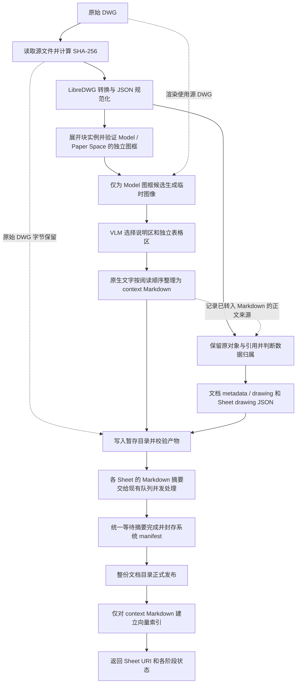

# DWGParser 当前链路流程说明

版本：DWGParser 10.2，在 10.1 的坐标、图框及数量修正基础上，完整保留 JSON 原始文字。Markdown 输出规则、区域模型调用、提示词及摘要链路未调整。

核对日期：2026-09-14（10.2 文字保全）；正式导入和 OVPack 的历史验证日期见下文。
适用范围：通过 `add_resource(bundle=true)` 正式导入 DWG，启用索引并等待处理完成。

当前链路以 **LibreDWG 的完整、规范化 JSON 为数据底稿**：先识别 Sheet，用临时图像辅助选择说明和独立表格，将这些正文整理成 Markdown，全部原生数据（包括已写入 Markdown 的文字）保存在文档级或 Sheet 级完整 JSON 中。OV 以 Sheet 为检索单位，自动摘要和 Embedding 只处理 Sheet Markdown；JSON 作为命中 Sheet 后可按需读取的证据。

10.2 的[固定输入消融](dwg-parser-v102-ablation.md)保留了选项框线段过滤和图框容差复用两项结果等价的优化，并删除已无调用入口的旧梁拓扑/文字切片生成器。JSON、Markdown 和模型处理边界不变。

## 1. 首次导入总流程



图中的分支表示数据用途。当前 Model 图框候选的区域请求按现有 `vlm.max_concurrent` 并发；底层渲染仍由原锁串行保护，可与已发出的网络请求重叠。所有结果按原候选顺序归并后，再整理 Markdown 和 JSON。Markdown 摘要阶段也支持跨 Sheet 并发。

## 2. 各阶段处理内容

| 阶段 | 做什么 | 主要输出 | 是否调用模型 |
|---|---|---|---|
| 读取源文件 | 读取原始字节，计算 SHA-256，确定来源标识 | 源 DWG 快照、来源信息 | 否 |
| LibreDWG 转换 | 调用 `dwgread`，完整读取顶层字段和 `OBJECTS`，处理不合法的编码和数值表示 | 内存中的规范化 JSON | 否 |
| Sheet 识别 | 展开 Model / Paper Space 的块实例，核验实际边界及标题栏证据 | Sheet 候选、多边形、范围、稳定标识及诊断 | 否 |
| 临时渲染与区域选择 | 渲染 Sheet 图像，让 VLM 选择说明、独立表格区域，并校验候选是否为 Sheet | 区域类型和范围 | VLM |
| Markdown / JSON 整理 | 从原生文字生成 Markdown；保留其余字段，按作用域和空间顺序组织 JSON | `context*.md`、`metadata.json`、`drawing.json` | 否 |
| 暂存与产物校验 | 写入源文件和产物，校验目录、白名单、JSON 语法及哈希等 | 待发布目录、产物清单信息 | 否 |
| Sheet 摘要 | 对允许的 Markdown 生成文件摘要和 Sheet 系统摘要 | 如 `.abstract.md`、`.overview.md` | 文本模型调用 |
| 封存与发布 | 汇总摘要，写根和 Sheet 的系统清单，将整树发布到正式 URI | 正式 DWG 文档及 Sheet Bundle | 否 |
| 向量索引 | 只对各 Sheet 的 `context*.md` 入队向量化，并按调用参数等待完成 | Markdown 向量、索引状态 | Embedding |

“数据保全”的比对基线是规范化后的 LibreDWG JSON；原始 DWG 字节另外完整保留。临时转换文件会清理，不额外保存一份长期的完整 `structure.json`。

### Sheet 识别与渲染

Sheet 的标识由源文件和原生位置标识生成，图名、图号用于展示，不靠 VLM 命名每张图。识别 Sheet 不会导出独立的 `sheet.dwg`。

当前已验证的主要路径是 **Model Space 图框**。10.1 的确定性识别步骤为：

1. 按 LibreDWG 的 OCS/extrusion、块基点、插入点、缩放和旋转，在三维中组合嵌套实例变换，最后投影到二维；Sheet 识别与 JSON 归属共用坐标实现。
2. 核验闭合直边多段线，或能由真实 LINE 拼成的矩形；保留旋转边界，不把任意块的包围盒当作图框。LibreDWG LWPOLYLINE 的闭合标志为 `512`，`1` 不能用作闭合标志。
3. 使用局部文字尺寸、标题字段、目录、图框块名称等证据筛选，排除空占位格、打印样式示例、重复内框及普通构件；不再以全图最大包围盒的百分比决定最小图纸尺寸。外框包含多个独立标题栏时才考虑拆为子图纸。
4. 文字和原生对象使用实际边界多边形判断归属；旋转图框的轴对齐包围盒只用于粗筛。

Paper Space 可以包含多个独立图框；仅有 VIEWPORT 的 Layout 不单独计数。零散表格边框或标题栏不足以确认独立 Sheet，会保留为 `layout_unframed`。当前不对 Paper Space 执行图像渲染和 VLM 区域选择，Viewport 投影及 Model/Paper 重复图纸对应关系仍未完整实现，相关内容保持 `partial`。

`document.sheet_count` 表示保留下来的有图框 Sheet 数量；`sheet_bundle_count` 表示实际存储的 Bundle 数量，包含未确定图框的内容容器和 synthetic 回退，因此两者可能不同。`detection_statistics` 记录候选、模型拒绝、无框容器、回退容器等数量；其中 `boundary_only_sheet_count` 表示只有边界证据的弱候选，不能视为已核实的带编号图纸。候选模型诊断、几何问题、边界及来源引用会写入 metadata JSON。

几何识别仍是启发式推断，不是 DWG 自带的子图纸清单。代理对象、未支持的曲线/图框、缺失标题证据和复杂空间对应关系仍可能影响数量。

视觉输入另走临时渲染路径：通过 ODA File Converter 和 ezdxf 读取用于显示的内容，生成 Model Space 绘制记录，再按 Sheet 范围裁出图像。该渲染结果在一次解析中复用，图像不作为长期 parser 产物保存。临时显示文字的修复不改写原始 DWG 或原生 JSON 字段。

候选线程复用现有异步模型接口和共享事件循环；每个任务继承请求上下文，完成顺序不会改变 Sheet 顺序。渲染失败缓存也在锁内检查，避免多个等待任务重复初始化已经失败的渲染器。这里的区域并发上限作用于一次 DWG 构建，不是多个同时导入与所有摘要调用共享的全服务总额度。

### VLM 只辅助选择文字区域

VLM 接收 Sheet 图像和区域选择指令，不接收保存下来的 JSON 数据文件。它返回说明区、独立表格区或不确定区域的类型和图像边界；Sheet 的 CAD 范围留在本地，用于把返回的图像坐标换算为 CAD 坐标，再选择对应的原生文字。

- 正文来自 LibreDWG 原生文字，VLM 不负责重写整张图的 JSON，也不承担正文 OCR。
- 不再划分、命名或保存独立 View，不进行第二轮局部复看。
- 纯图纸返回空区域列表是正常情况，图区内的文字仍留在 JSON。
- 仅明确返回 `is_sheet=false` 的候选会被排除；未知区域、渲染或识别不可用会记录不确定状态。
- 若最终没有有效候选，保留一个合成的 `partial` Bundle 表示；它不计入 `sheet_count`，原始数据仍保留。

### Markdown 整理与原文保留

现有文字、表格和阅读顺序逻辑生成 `context.md`；内容超过 Markdown 配置预算时生成 `context_001.md` 等多份文件。标题栏中可解析的图名、图号等信息仍由原有逻辑整理为 Sheet 元数据，不属于 VLM 选择的说明正文。

没有 document/table 区域时，10.1 跳过不参与正文输出的表格网格和选项框重建，仍提取元数据并保留原生 JSON。

Markdown 是用于召回的派生副本，不再替代 JSON 原文。即使标签被区域分类选入 Markdown，JSON 仍完整保留 `text`、`text_value`、坐标及对象的其他字段；原生表格结构和块定义同样保留。已有 Markdown 内容不做额外删减，必要的 Markdown 来源引用继续保留，新产物不再生成表示字段迁移的 `markdown_fields`。

这一规则随 10.2 生效。已有入库产物或旧 OVPack 不会自动补回被删除的文字；需要重新解析原始 DWG，不能仅通过 reindex 恢复。

### 摘要并发与发布顺序

系统先检查所有 Sheet 的标识、目录、内容白名单和 JSON 产物，再将各 Sheet 摘要交给已有队列。不同 Sheet 可以并发，同一 Sheet 内仍先生成文件摘要，再生成目录摘要。并发量服从现有配置；T0202 本次实测最高同时处理 4 个 Sheet，不是代码固定只支持 4 个。

共享摘要调度器按“忙碌 worker + 待处理任务”补充 worker，仍受原并发上限约束。已有 worker 忙碌时，新任务不会因为队列较短而无故串行等待；文件摘要和目录摘要的用途与调用规则保持不变。

整批摘要统一等待、统一清理请求跟踪状态，全部成功后才封存 manifest 并发布。向量化在正式发布之后执行。因此，“解析完成”“摘要完成”“索引完成”是不同状态，不能混为一项。

## 3. 最终目录及文件职责

```text
<dwg-document>/
├── <original-name>.dwg
├── manifest.json
├── metadata.json
├── drawing.json
└── sheets/
    └── <sheet-id>__<title>/
        ├── manifest.json
        ├── context.md 或 context_*.md
        ├── drawing.json
        ├── .abstract.md           # 系统摘要
        └── .overview.md           # 系统摘要
```

| 文件 | 保存什么 |
|---|---|
| 原始 DWG | 完整源文件字节；每个文档保存一份，各 Sheet 引用它 |
| 根 `metadata.json` | 顶层字段、文档和 Sheet 描述、块定义及内部图形、非图形对象等 |
| 根 `drawing.json` | 跨 Sheet、框外、位置未知，或不能可靠且唯一归入某个 Sheet 的放置对象 |
| Sheet `drawing.json` | 可可靠、唯一归入本 Sheet 的放置对象，按现有空间顺序组织 |
| Sheet `context*.md` | Sheet 元数据，以及已选择的说明正文和独立表格的可读内容 |
| 系统 `manifest.json` | 来源、文件路径、哈希、检索标记及处理状态等清单信息 |
| 系统摘要文件 | Sheet 的简短摘要和概述，供 OV 使用；正式 DWG 索引不单独向量化这些目录摘要 |

**metadata 内含实际图形数据。** 例如块内部的线条和文字保存一次；drawing 中的 INSERT 保留原生块引用和变换。读取某个 Sheet 时，可能还需要读取 metadata 中被引用的定义，不能把一个 Sheet 的 drawing 文件当成已经展开的全部几何。

新 JSON 使用 `openviking.dwg-json/v1`，以 `records` 数组保存原对象及其原始序号。空间排序只改变记录的排列和存储作用域，不改写源坐标；依靠对象序号可恢复 `OBJECTS` 原顺序。

JSON 按最终保留的 Sheet 范围判断归属，不按 VLM 的说明区或 View 边界切分。

每个文档固定有根 metadata 和 drawing，每个 Sheet Bundle 有一份 drawing；空作用域保留空数组。因此有 N 个 Bundle 时，parser JSON 共 **N + 2 份**，不含系统 manifest。JSON 不再受 2048 tokens / 6000 字符的持久化分片限制，也不生成 fragment。旧版本分片仍可读取和重组。

## 4. 哪些内容进入模型

| 内容 | 自动 VLM / 摘要 | Embedding | 问答时按需读取 |
|---|---|---|---|
| 临时 Sheet 图像 | 用于说明、表格区域选择 | 否 | 不作为长期产物提供 |
| Sheet `context*.md` | 进入 Markdown 摘要流程 | 是 | 是 |
| `metadata.json`、所有 `drawing.json` | 否 | 否 | 是 |
| 原始 DWG | 本流程只作源文件和临时渲染来源 | 否 | 可以取得源文件 |

JSON 的排除规则也覆盖父目录刷新、混合目录、摘要/索引重建和最终向量入队等入口。系统依据有效 DWG 清单或新旧 JSON schema 判断产物身份，不依赖文件是否名为 `chunks`。

自动处理的排除不限制问答阶段读取 JSON：Agent 可以先检索 Sheet，再读取 Markdown，必要时通过已有 `grep` 定位对象字段，并用 `read(offset, limit)` 读取附近行。当前分页按行返回，服务端仍先读取文件再切行；返回片段不一定是独立合法 JSON，也没有新增 handle/block/bbox 专用查询接口。

## 5. 已有产物的 ovpack 复用流程


导出时使用 `include_vectors=true`。目标 OV 已完成初始化、且向量兼容时，用 `vector_mode=require` 恢复，要求直接复用包内向量；不兼容时应失败，不静默改成重新 Embedding。

这条路径不经过 DWG 转换、渲染、VLM 区域选择或 Markdown 摘要。它复用已有 OVPack 能力，没有额外增加以源文件哈希为键的 parser 缓存系统。parser、模型、提示或语料版本改变后，需要重新生成对应产物，旧包不能代表新版本解析结果。

包通过完整校验后使用内部 Bundle 写入路径恢复清单；普通文件写入仍不能创建或修改 Bundle，导入目标也不能位于已有 Bundle 内部。

## 6. 状态和失败边界

| 状态 / 情况 | 含义及处理 |
|---|---|
| `parse_status=partial` | 存在无法可靠判断的区域、几何或空间归属；原始数据仍保留，不等于内容被丢弃 |
| `semantic_status=complete` | 本次摘要组装已完成，不代表所有几何或文字语义已被正确理解 |
| `vector_status=complete` | 本次向量任务完成；若未等待或未启用索引，应按返回的 queued/skipped 等状态处理 |
| 转换、产物校验或摘要组装失败 | 不发布该暂存文档，进入清理 / 回滚流程 |
| 发布后的索引失败或超时 | 按索引状态或异常处理；文档已经发布，不能假定它和摘要阶段一起回滚 |

多 Sheet 摘要批次超时后，会先等待已接收的 worker 收束，再清理暂存数据并返回错误，因此错误返回可能晚于配置的 timeout。该行为防止回滚后发生迟到写入。

当前仍有多栏阅读顺序、表格规整、SHX 字符以及不支持几何等局限。数据保全、成功入库和答题正确率分别验证，不用其中一项代替其他项。

## 7. T0202 的历史导入记录（10.0）

以下是 10.0 的历史运行数据，19 是旧算法结果，包含误识别，不能作为实际图纸数量。10.1 不调用模型的原始 JSON 回归识别为 18 张，与已复核的 17 张编号图纸和 1 张目录一致；没有重新执行整套正式导入、摘要或索引来更新下表耗时。

2026-09-10 对同一份 T0202 实测得到：

| 项目 | 结果 |
|---|---:|
| Sheet | 19 |
| Markdown | 23 份 |
| parser JSON | 21 份 |
| 原生对象保全 | 37,749 个及全部顶层字段 |
| 正文迁移及来源覆盖检查 | 2,145 个字段 |
| 正式向量 | 23 条 Markdown，0 条 JSON |
| 首次导入服务端耗时 | 170.268 秒；此前 v9 为 291.452 秒 |

本次 Sheet 渲染、区域请求和 Markdown 整理合计墙钟时间为 48.659 秒，摘要批次为 110.409 秒，JSON 生成为 2.349 秒。19 个区域调用的累计时长为 99.449 秒，但存在并发重叠，不能把它再加到上述墙钟时间中。

固定本次 19 份区域返回后，v9 串行与 v10 并发生成的 Sheet 描述、23 份 Markdown、21 份 JSON 逐字节一致，并与实际发布产物一致。此前 v9 实跑的 24 份 Markdown 与本次 23 份的差异来自不同的区域返回，不能作为并发造成内容变化的证据。摘要批次耗时变化也不能单独归因于 worker 补位修正。

包恢复机制本轮未改变；此前 v9 的独立测试为 0.750 秒，恢复和重新导出窗口内无模型调用尝试，初始化另计。本次 v10 已验证原生导包，未重复测量包恢复速度。

这是单文件实测，不代表所有 DWG 的耗时。当前未执行 v10 的 55 题正确率对照；两次实跑的 VLM 返回也可能不同。

## 8. 实现与证据入口

| 部分 | 代码入口 |
|---|---|
| DWG 转换、规范化与产物暂存 | `openviking/parse/parsers/dwg.py` |
| Sheet、文字和表格整理 | `openviking/parse/parsers/dwg_sheet.py` |
| 临时渲染 | `openviking/parse/parsers/dwg_render.py` |
| 原生对象归属、完整 JSON 与旧分片读取 | `openviking/parse/parsers/dwg_json.py` |
| 批量摘要、清单封存、发布与索引 | `openviking/service/resource_service.py` |
| DWG 数据身份和自动处理排除 | `openviking/resource/atomic_bundle.py` 及其调用方 |
| 包导入导出及向量恢复 | `openviking/storage/ovpack/operations.py` |

进一步查看：[当前设计取舍](dwg-parser-spatial-chunks.md)、[Sheet 检索 ADR](../adr/0013-make-dwg-sheets-the-retrieval-unit.md)、[实现与验证记录](dwg-parser-json-validation.md)。

T0202 本次实测证据位于 `.local-data/dwg-concurrent-t0202-v10-20260910/`，其中 `review/README.md` 为浏览入口，`audit/import-timing.json` 为分阶段耗时，`audit/t0202-recorded-response-ablation.json` 为固定返回回放。此前包复用验证保留在 `.local-data/dwg-whole-t0202-v9-20260910/readback-fixed/audit/readback-validation.json`。
