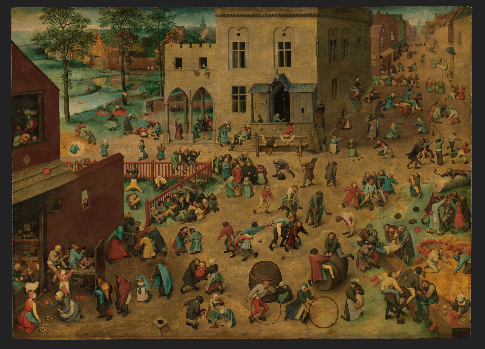
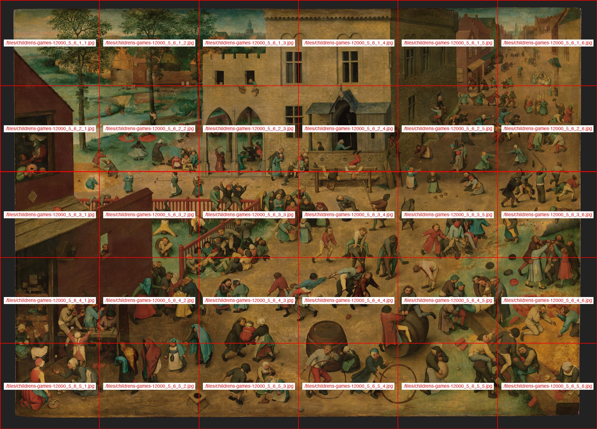
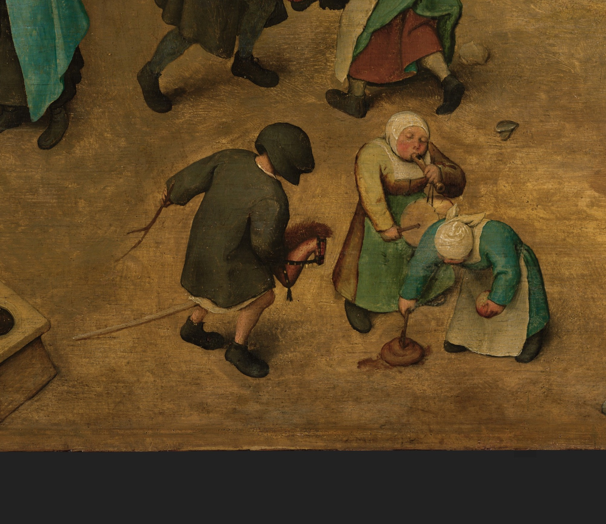

# Super-large image block retrieval demo

**Date:** 2026-07-29

**Result:** `PASS`

## Demo

Source: Pieter Bruegel the Elder, *Children's Games* (1560), from [Wikimedia Commons](https://commons.wikimedia.org/wiki/File:Children%27s_Games_(Bruegel).jpg). The source page marks the image as public domain and provides a 41,519 x 29,944 original (243.6 MB, about 1.24 gigapixels).

The current OpenViking large-image path was added by commit `3c70f8d3` on 2026-07-16. It activates above 10 MB or 4096 px, creates a 2048 px preview, and divides the image into tiles no larger than 2048 px.

For a stable runnable demo, the public-domain original was retained as source evidence and resized to 12,000 x 8,654 (103,848,000 pixels, 25.63 MB) before import. OpenViking produced a 5 x 6 grid and 30 searchable tiles at:

`viking://resources/demos/childrens-games-12000`

### Question

> 画中骑木马的孩子旁边，另外两个孩子分别在做什么？

### Retrieval

```shell
ov find '画中骑木马的孩子旁边，另外两个孩子分别在做什么？' \
  -u 'viking://resources/demos/childrens-games-12000' -n 3 -L 2 -o json
```

Top result:

```text
viking://resources/demos/childrens-games-12000/tiles/childrens-games-12000_5_6_5_3.jpg
score: 0.4182443916797638
```







### Same-model blind comparison

Both requests used `doubao-seed-2-0-pro-260215`, temperature 0, thinking disabled, the same question, and no retrieval text.

| Input | Answer | Prompt tokens |
| --- | --- | ---: |
| 2048 px full preview | `无法确定` | 1,411 |
| retrieved tile `5_3` | `一个孩子坐着吹木笛、敲手鼓，另一个孩子弯腰玩抽陀螺，手里还拿着一个苹果。` | 1,405 |

Response IDs:

- full preview: `resp_0217852946643752e04e38e7721c264a1a6c60a399a3e0422fde0`
- retrieved tile: `resp_02178529466449881a9193ce9f89e3456d252c7b9d01d036c7dfd`

## Boundary

This proves that block-level semantic retrieval can recover a detail that the whole-image preview cannot answer. It does not prove arbitrary-gigapixel scalability: the current implementation decodes the input and generates every tile eagerly. The 1.24-gigapixel original exceeds Pillow's default decompression-bomb limit, so the verified OpenViking input is the 103.8-megapixel derivative. It also generated VLM summaries for the preview, grid, and all 30 tiles, so this is an accuracy demo rather than a low-cost ingestion design.
